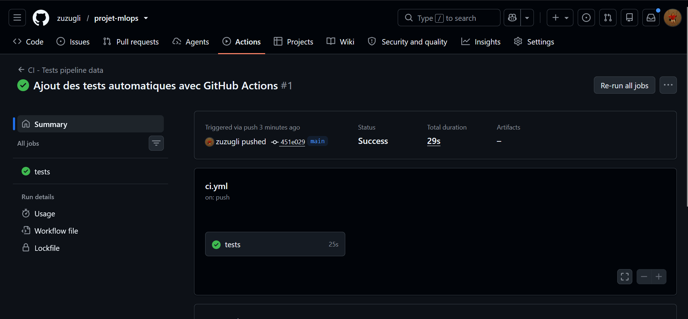
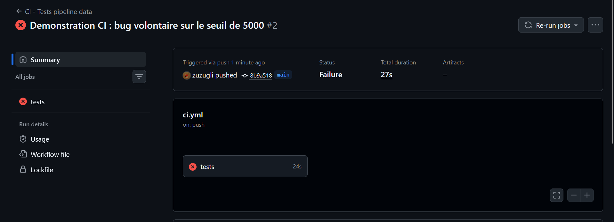
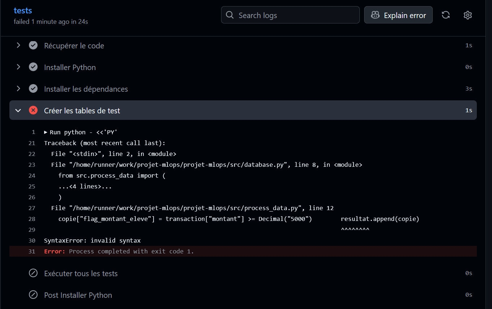
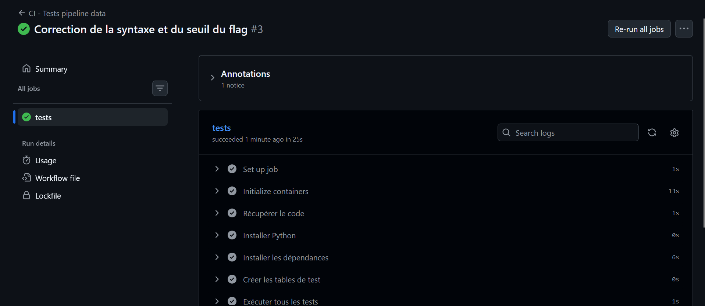
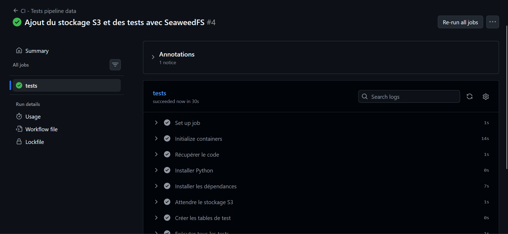

# Échec de pipeline et correction

## Situation initiale

La CI réussit après l'ajout des tests automatiques.

## Cause et échec

Pendant une modification du seuil du flag, deux instructions Python ont été collées
sur une même ligne dans `ajouter_flags` : le module n'était plus interprétable.

L'erreur capturée est `SyntaxError: invalid syntax`. L'échec survient à l'étape
« Créer les tables de test » : elle importe `database`, qui importe `process_data`.
Les tests n'ont donc pas été exécutés dans cette exécution. Cette capture ne montre
pas une assertion de test ayant détecté le mauvais seuil.

## Correction et réussite

Les instructions ont été séparées. Le seuil a également été rétabli à `> 5000`.
Après commit et push, le workflow réussit à nouveau.

## Extension S3 (capture facultative)

